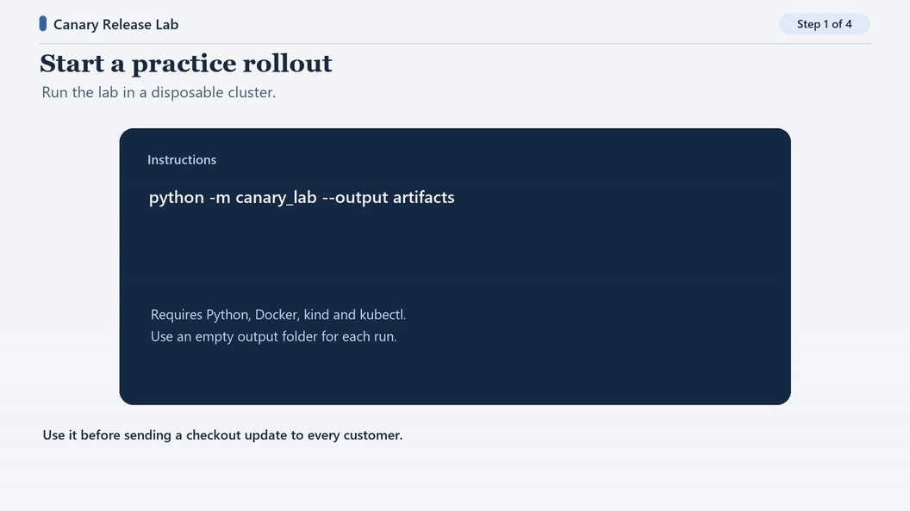

# Canary Release Lab

Deploy a small checkout API on Kubernetes, promote a healthy candidate, and automatically abort a candidate that returns HTTP 500s. Argo Rollouts makes the release decision using Prometheus metrics from live traffic.

<!-- portfolio-demo-videos -->
## Watch the demo

Use it before sending a checkout update to every customer. The walkthrough has on-screen captions.



[Download the narrated walkthrough](docs/demo/how-to.mp4?raw=true) · [Download the narrated overview](docs/demo/overview.mp4?raw=true)

<!-- /portfolio-demo-videos -->

## Run the demo

Use Python 3.12, Docker with Linux containers, kind, and kubectl. The runner uses a pinned kind node image and installs Argo Rollouts v1.10.2 and Prometheus v3.16.0.

```sh
python -m canary_lab --output artifacts
```

The runner creates a uniquely named kind cluster with a private kubeconfig, builds the checkout image, and deletes the cluster when it finishes. Use a fresh output directory for each run. The command needs outbound network access to download the pinned dependencies.

## What the demo proves

| Stage | Expected result |
| --- | --- |
| Baseline v1 | The shared endpoint serves successful requests from v1. |
| Healthy v2 | Traffic reaches both the candidate and stable replicas. Prometheus confirms enough candidate requests and a 5xx rate at or below 3%. Argo promotes v2. |
| Faulty v3 | The candidate returns a 500 on every third checkout. Argo's candidate-specific 5xx check fails, and v2 remains the stable version. |
| Recovery | The shared endpoint serves at least 50 consecutive successful requests from v2 in one measurement window. |

The initial canary target is 25% by replica count, one of four replicas. Kubernetes assigns new connections among ready pods, so the report includes the actual fraction observed during analysis. The synthetic driver opens a new connection for each request and tags metrics using the version and revision returned by the API.

The traffic floor is checked separately from the error rate. With fewer than 15 candidate requests in the evaluation window, promotion is blocked even when the measured 5xx rate is zero. The expected failure must come from the 5xx check, so a bad Prometheus setup cannot pass the rollback demonstration.

After abort, Argo keeps serving the last promoted revision. The requested faulty revision remains visible in the Rollout resource. An operator using GitOps would still revert or fix the requested version in Git.

## Inspect the evidence

`artifacts/report.json` includes the release decisions, per-version request counts, Prometheus measurements, and elapsed time from the runner observing the failed analysis to confirming a stable-only traffic sample. Rollout resources, AnalysisRuns, pod status, events, and recent logs are captured for diagnosis. Kubeconfig stays in the temporary directory and is excluded from evidence.

GitHub Actions runs the same commands on a fresh kind cluster and uploads the **canary-evidence** artifact.

## Local tests

```sh
python -m unittest discover -s tests -v
```

These tests cover fault scheduling, revision-labeled request metrics, and detection of a counter reset between measurements.
